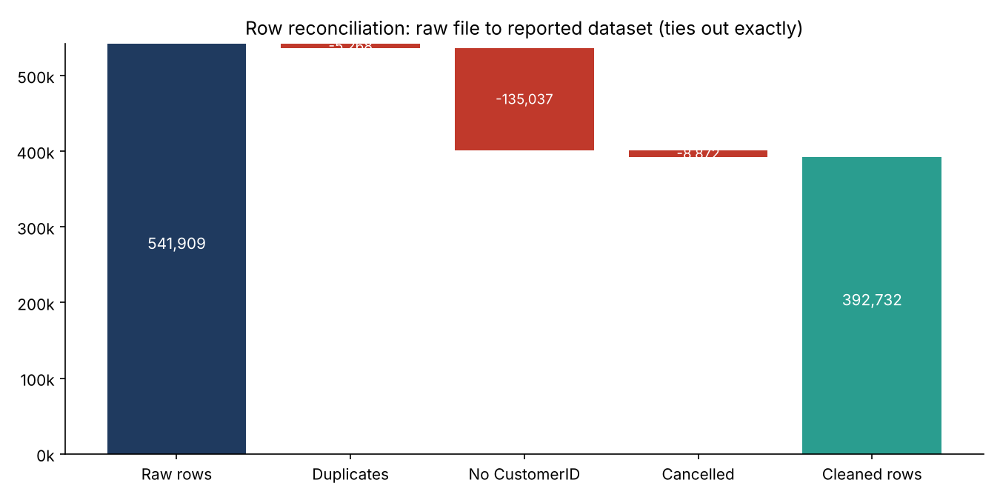
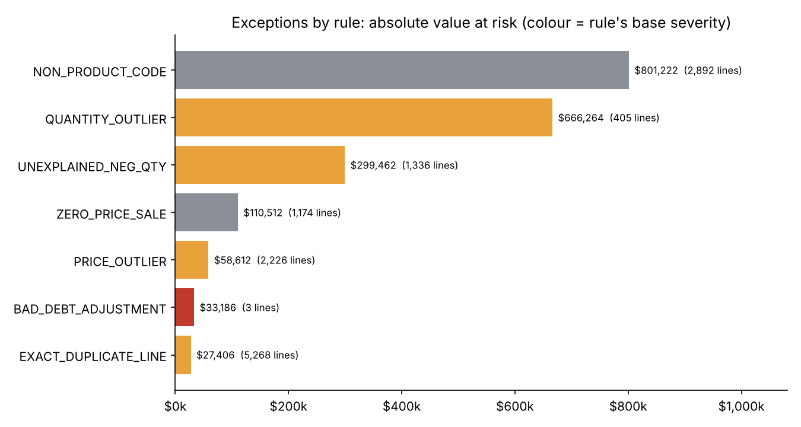
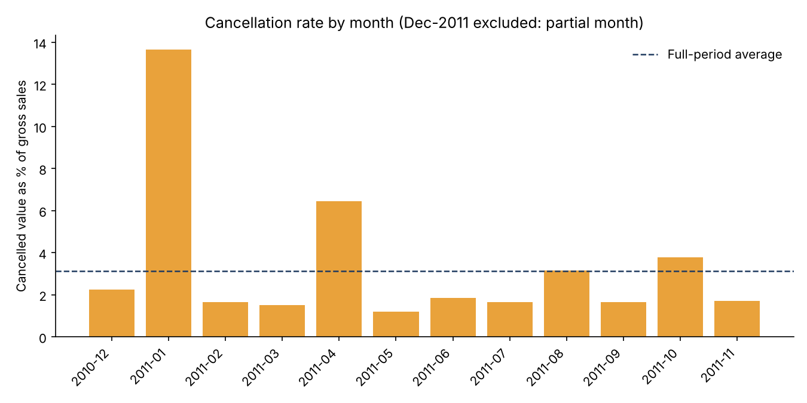
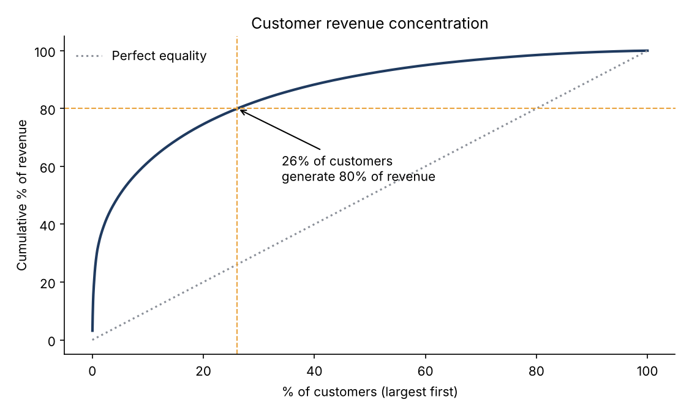
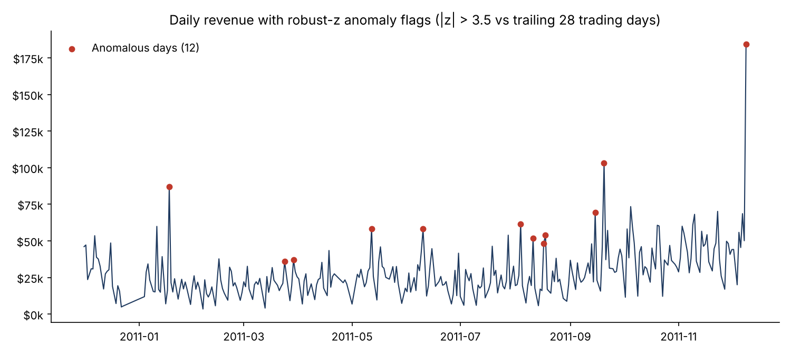
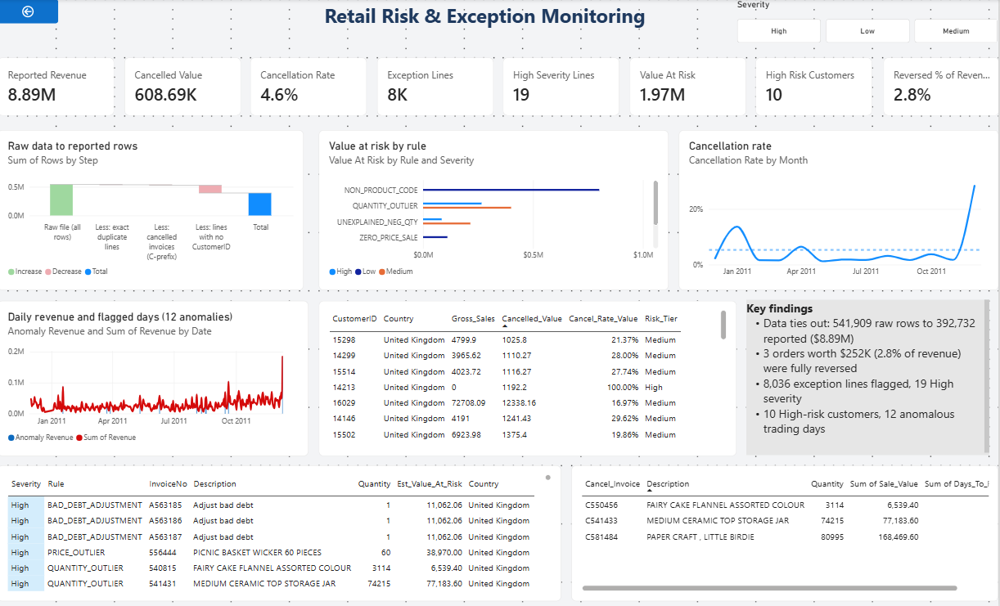

# Retail Business Performance Reporting, Risk & Exception Monitoring

## Executive Summary
This project analyzes 541,909 online retail transaction records using Python, SQL, Excel, and Power BI. It has two parts:

1. **Business performance reporting**: sales trends, customer behavior, product performance, KPI dashboard.
2. **Risk & exception monitoring** (added): reconciliation of raw data to reported KPIs, rule-based exception detection, cancellation analysis, concentration risk, daily anomaly detection, and ranked customer and product watchlists, delivered as an Excel exception report and SQL queries.

The second part answers the questions a risk or MIS team asks of operational data: *Do the numbers tie out? What looks wrong? Where is the exposure? Who and what needs follow-up?*

---

## Headline Findings (Risk & Exception Monitoring)

| Finding | Evidence |
|---|---|
| Raw-to-reported data **reconciles exactly** | 541,909 raw rows - 5,268 duplicates - 135,037 rows with no CustomerID - 8,872 cancelled lines = 392,732 reported rows. Value bridge ties to the cent. |
| **Reported revenue is gross of cancellations** | Cancelled invoices (C-prefix) for identified customers total **$608,689 (6.8% of reported revenue)** and were removed from the data without being netted off. |
| **Large orders that were later fully reversed sit inside reported revenue** | Three orders totalling **$252,193 (2.8% of reported revenue)** were cancelled in full. Two were same-day reversals of 80,995 and 74,215 units, and they rank #1 and #5 in the "top products by revenue" list. |
| **25% of rows cannot be attributed to a customer** | 135,037 lines with net value of **$1.45M (about 16% of reported revenue)** are excluded from customer analysis. |
| **8,036 exception lines logged, 19 High severity** | Bad-debt adjustments, 5,000+ unit orders, price outliers, unexplained negative quantities (free-text notes such as "check", "?", "damaged"), zero-price issues, fees mixed into product data. |
| **Cancellations are concentrated in time and in a few customers** | Overall cancellation rate is 4.6% of gross product sales, but 13.7% in Jan 2011 and 6.5% in Apr 2011. **10 High-risk and 23 Medium-risk customers** are on the watchlist. |
| **Revenue is highly concentrated by geography** | UK = 82.9% of product revenue (HHI 6,905 of 10,000). The largest non-UK market (Netherlands) is 3.2%. About 26% of customers generate 80% of revenue. |
| **Daily anomaly detection works** | 12 trading days breach a robust z-score of 3.5 versus the trailing 28 trading days. Two of them (18 Jan 2011 and 9 Dec 2011) are the two large reversed orders above. |

### Correction to earlier figure
An earlier version of this README stated that the top 10 products generated about 14.4% of revenue. Recomputing from `outputs/03_top_products.csv` gives **about 10.0%** of reported revenue (9.5% excluding postage and manual-entry codes). The figure has been corrected here.

---

## Business Problem
Retail businesses generate large volumes of transactional data, but turning it into trustworthy reporting requires two things: insight into performance, and confidence that the data behind the KPIs is complete, accurate, and free of unexplained exceptions.

This project aims to:
- Identify sales and revenue trends and customer behavior
- Generate business KPIs for reporting
- Verify that reported KPIs reconcile to source data
- Detect transactions that break business rules and quantify the value exposed
- Identify where cancellations, concentration, and anomalies create risk
- Produce ranked follow-up lists a team can act on

---

## Dataset Information
The dataset contains online retail transaction records (UK-based retailer, 1 Dec 2010 to 9 Dec 2011):
- Invoice details, product descriptions, quantity sold, unit price
- Customer ID, country, transaction date

### Dataset Scale
- 541,909 raw transaction records
- 392,732 records in the cleaned reporting dataset
- 4,339 unique customers
- 18,536 completed orders

---

## Tools & Technologies
- Python (Pandas, NumPy, Matplotlib, openpyxl)
- SQL (SQLite)
- Excel (Tables, COUNTIFS / SUMIFS, formula-driven summaries, PivotTable-ready log)
- Tableau Public (performance dashboard)
- Power BI (risk dashboard, see `dashboard/powerbi_risk_dashboard_guide.md`)
- Jupyter Notebook

---

## Part 1: Business Performance Reporting

### Data Cleaning & Preprocessing
- Removed duplicate records
- Removed rows with missing customer identifiers
- Converted transaction dates into datetime format
- Removed cancelled transactions
- Created revenue-related calculated fields
- Standardized and validated transactional data

### Exploratory Data Analysis and SQL Analysis
- Monthly revenue trend, top and bottom products, revenue by country
- Average order value, customer lifetime value, spend-based segmentation (High / Mid / Low / Micro)
- Revenue concentration analysis
- KPI summaries and top customer rankings via SQLite (`sql_analysis.py`)

### Key Business Metrics (reported, gross of cancellations)
- Total Revenue: **$8.89M**
- Total Orders: **18,536**
- Total Customers: **4,339**
- Average Order Value: **$479**
- UK contributed approximately **82%** of reported revenue
- Top 10 products generated approximately **10.0%** of reported revenue
- A relatively small group of high-value customers contributed disproportionately to sales

---

## Part 2: Risk & Exception Monitoring

### 1. Reconciliation
Every step between the raw file and the reported dataset is bridged in rows and dollars (`outputs/risk/r01_reconciliation_bridge.csv`, sheet `Reconciliation`). The check cell in the Excel report must read 0.



### 2. Exception rules
Each transaction is tested against explicit, documented rules. One line is logged per flagged transaction. Thresholds are defined at the top of `risk_exception_analysis.py`.

| Rule | What it catches | Base severity |
|---|---|---|
| BAD_DEBT_ADJUSTMENT | Manual "Adjust bad debt" invoices (these carry negative unit prices) | High |
| QUANTITY_OUTLIER | Quantity >= 20x the product median (and >= 500 units), or any single line >= 5,000 units | Medium (High if value >= $5,000) |
| PRICE_OUTLIER | Unit price >= 5x or <= 1/5 of the product's median price | Medium (High if value >= $5,000) |
| UNEXPLAINED_NEG_QTY | Negative quantity on a non-cancellation invoice (write-offs, damages, stock fixes) | Medium (High if value >= $5,000) |
| ZERO_PRICE_SALE | Goods issued at zero price (value estimated at the product's median price) | Low |
| NON_PRODUCT_CODE | Postage, fees, manual or sample codes mixed into product data | Low |
| EXACT_DUPLICATE_LINE | Identical row repeated (summarised, not logged line by line) | Medium |
| MISSING_CUSTOMER_ID | Transaction cannot be attributed to a customer (summarised) | Medium |



Value at risk is the absolute transaction value, or for zero-value lines, quantity x the product's median price. It measures exposure, not confirmed loss. A flag is a prompt for review, not proof of error.

### 3. Cancellations and returns
Cancellation rate = cancelled value / gross sales value, product SKUs only (fees, postage, and manual codes excluded), by month, country, product, and customer.



Note: Dec 2011 is excluded from the chart because data ends on 9 Dec 2011, and a single $168K same-day reversal dominates that partial month.

### 4. Concentration risk
Top-N share, Herfindahl-Hirschman Index (HHI), and the number of entities needed to reach 80% of revenue, for country, product, and customer.



### 5. Daily revenue anomalies
A robust z-score (median and MAD over the trailing 28 trading days) flags days that deviate from recent history. Seasonal peaks can trigger flags, so each one needs context.



### 6. Watchlists
- **Customer watchlist**: High tier = cancelled >= 30% of purchases and >= $1,000. Medium tier = >= 15% and >= $500. Ranked by cancelled value.
- **Product watchlist**: products with a cancellation rate >= 15% or a price spread >= 5x versus the median, with at least $1,000 of sales.
- **Reversed orders**: large cancellations that exactly mirror an earlier sale (same customer, product, and quantity).

---

## Recommendations (Risk-Focused)
1. **Report net revenue alongside gross.** Show cancelled value (6.8% of reported revenue here) as a visible KPI so leadership is not reading a gross number as a net one.
2. **Add an approval check for very large orders.** Orders above a unit or value threshold (for example 5,000 units) should need credit and stock confirmation before they count as sales. Two such orders were cancelled the same day.
3. **Require reason codes for stock adjustments.** Negative-quantity lines carry free-text notes like "check", "?", and "damaged", which cannot be audited or trended.
4. **Fix customer identification at the point of sale.** A quarter of rows have no CustomerID, so $1.45M of sales cannot be tied to a customer.
5. **Review pricing controls on products with wide price spreads** (for example one SKU sold between $2.00 and $649.50).
6. **Reconcile manual bad-debt adjustments** (three entries totalling $33K) back to supporting documents.
7. **Follow up the High-tier customers** and the products with the highest cancellation rates.

---

## Limitations
- Public UK online-retail data from 2010-11, used as a practice dataset; it is not a grocery or multi-outlet retail dataset.
- Thresholds (5x price, 20x quantity, 30% cancellation) are judgement calls and can be changed in the script. Different thresholds will produce different counts.
- Exceptions are flags for review. Without business context, some will be legitimate (bulk orders, promotional pricing).
- Cancellations are matched by customer, product, and quantity; partial reversals are not matched.

---

## How to Reproduce
```bash
pip install -r requirements.txt
python sql_analysis.py              # original KPI queries
python risk_exception_analysis.py   # reconciliation, exceptions, watchlists, charts, Excel report
python sql_risk_queries.py          # SQL risk queries (reconciles to the Python results)
```

---

## Project Structure

```text
retail-business-performance-analytics/
│
├── data/
│   ├── online_retail.csv
│   └── cleaned_retail_data.csv
├── notebooks/
├── excel/
│   └── Retail_Risk_Exception_Report.xlsx
├── dashboard/
│   ├── retail_analytics_dashboard.twb
│   └── powerbi_risk_dashboard_guide.md
├── outputs/
│   ├── (original SQL KPI outputs)
│   └── risk/
│       ├── r01 ... r10 (CSV tables, Power BI / Tableau ready)
│       └── sql/ (q1 ... q7 SQL query results)
├── images/
├── sql_analysis.py
├── risk_exception_analysis.py
├── sql_risk_queries.py
├── requirements.txt
└── README.md
```

---

## Dashboard Preview

### Risk dashboard (Power BI)


### Performance dashboard (Tableau)

---

## Author
**Masud Mondol**
