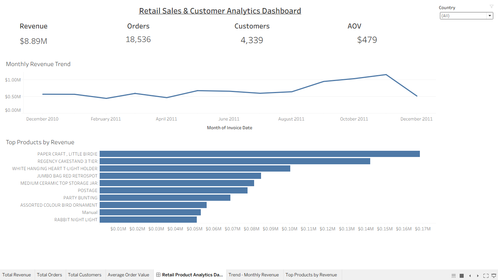

# Retail Sales & Customer Analytics Dashboard

## Project Overview
This project analyzes online retail transaction data to uncover sales trends, customer behavior, and top-performing products using Python and Tableau.

The workflow includes:
- Data cleaning and preprocessing using Pandas
- Exploratory Data Analysis (EDA)
- KPI generation
- Revenue trend analysis
- Product performance analysis
- Interactive Tableau dashboard creation

---

## Tools & Technologies
- Python
- Pandas
- NumPy
- Matplotlib
- Tableau Public
- Jupyter Notebook

---

## Key Insights
- Total Revenue: $8.89M
- Total Orders: 18,536
- Total Customers: 4,339
- Average Order Value (AOV): $479

---

## Dashboard Features
- KPI Cards
- Monthly Revenue Trend
- Top Products by Revenue
- Country Filter
- Interactive Dashboard Design

---

## Project Structure

```bash
retail-sales-customer-analytics/
│
├── data/
├── dashboard/
├── images/
├── notebooks/
├── requirements.txt
└── README.md
```

---

## Dashboard Preview



---

## Future Improvements
- Customer segmentation analysis
- RFM analysis
- Sales forecasting
- Profitability analysis

---

## Author
Masud Mondol
